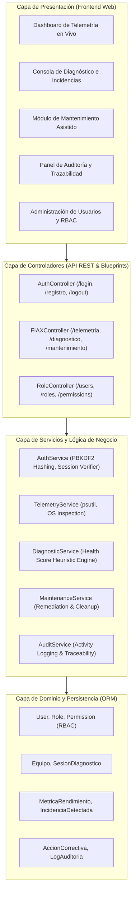
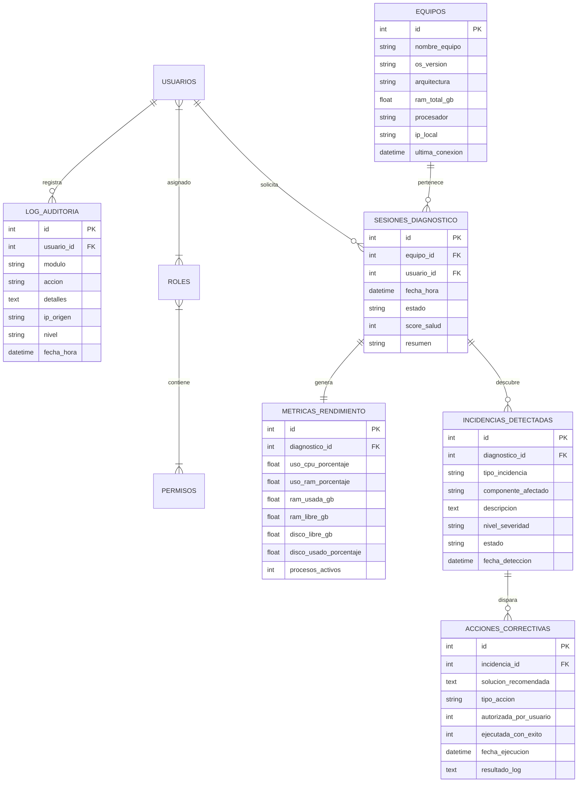

# FIAX CPU: Plataforma de Diagnóstico Heurístico, Telemetría y Mantenimiento Asistido
## Documento Técnico de Defensa de Proyecto - 10mo Semestre de Ingeniería de Sistemas

---

### 1. Ficha Técnica y Resumen Ejecutivo

- **Nombre del Proyecto:** FIAX CPU (Fault Inspection & Automated eXecution for Computers)
- **Versión de Avance:** v2.0 Web Architecture
- **Nivel Académico:** 10mo Semestre - Proyecto de Fin de Carrera / Tesis
- **Línea de Investigación:** Ingeniería de Software, Infraestructura Tecnológica y Sistemas Autónomos de Gestión TI
- **Stack Tecnológico:**
  - **Backend:** Python 3.14+, Flask 3.1 (Blueprints, Application Factory), SQLAlchemy 2.0 ORM, Werkzeug Security (PBKDF2-HMAC-SHA256).
  - **Telemetría & Diagnóstico:** `psutil` (Hardware Telemetry API), `platform`, heurísticas de análisis predictivo.
  - **Persistencia:** SQLite 3 con integridad referencial y claves foráneas activas (`PRAGMA foreign_keys = ON`).
  - **Frontend:** HTML5 semántico, CSS3 con variables y transiciones de aceleración por GPU, JavaScript Vanilla (Fetch API asíncrona), FontAwesome.
  - **Seguridad:** Role-Based Access Control (RBAC) granular con decoradores y tabla de auditoría inmutable (Compliance ISO/IEC 27001).

---

### 2. Planteamiento del Problema y Justificación

En los entornos organizacionales y domésticos modernos, las estaciones de trabajo sufren un fenómeno conocido como **degradación progresiva silenciosa**. La acumulación de archivos residuales, la fuga de recursos de subprocesos en segundo plano (*memory leaks*), la saturación de memoria caché y cuellos de botella en la paginación de disco provocan caídas drásticas de productividad.

Tradicionalmente, los departamentos de TI abordan el mantenimiento de manera **reactiva** (cuando el equipo ya colapsó) o con software intrusivo de terceros que satura el sistema operativo con publicidad o consumo excesivo de CPU.

**FIAX CPU** resuelve este problema implementando un **asistente ligero, no intrusivo y gobernado por un modelo cliente-servidor web** que:
1. Extrae telemetría de hardware en tiempo real sin impactar el rendimiento del host.
2. Evalúa la salud global del equipo mediante un **Algoritmo Heurístico de Puntuación (Health Score)**.
3. Clasifica anomalías por matrices de severidad (`BAJO`, `MEDIO`, `ALTO`, `CRITICO`).
4. Ofrece **remediación asistida y automatizada** (liberación segura de memoria residente, vaciado de caché DNS, purga de temporales).
5. Mantiene una **pista de auditoría forense** de todas las operaciones realizadas, cumpliendo los principios de gobierno de TI.

---

### 3. Arquitectura del Software (Clean Architecture / Layered Pattern)

El sistema ha sido estructurado siguiendo el principio de **Separación de Preocupaciones (SoC)** y alta cohesión con bajo acoplamiento:

---

### 4. Formulación Matemática del Motor Heurístico de Diagnóstico

Para cuantificar objetivamente el estado del equipo, se diseñó la función de **Health Score ($H$)**, acotada en el intervalo $[15, 100]$:

$$H = \max\left(15, \min\left(100, 100 - \left( P_{\text{cpu}} + P_{\text{ram}} + P_{\text{disco}} + P_{\text{temp}} + \sum_{k=1}^{n} w_{k} \right)\right)\right)$$

Donde las penalizaciones por estrés de recursos se definen por funciones escalonadas:

1. **Penalización por CPU ($P_{\text{cpu}}$):**
   $$P_{\text{cpu}} = \begin{cases} 18, & \text{si } U_{\text{cpu}} \ge 85\% \\ 9, & \text{si } 70\% \le U_{\text{cpu}} < 85\% \\ 0, & \text{si } U_{\text{cpu}} < 70\% \end{cases}$$

2. **Penalización por Memoria RAM ($P_{\text{ram}}$):**
   $$P_{\text{ram}} = \begin{cases} 22, & \text{si } U_{\text{ram}} \ge 88\% \\ 12, & \text{si } 75\% \le U_{\text{ram}} < 88\% \\ 5, & \text{si } 60\% \le U_{\text{ram}} < 75\% \\ 0, & \text{si } U_{\text{ram}} < 60\% \end{cases}$$

3. **Penalización por Capacidad de Disco ($P_{\text{disco}}$):**
   $$P_{\text{disco}} = \begin{cases} 25, & \text{si } D_{\text{libre}} \le 15\text{ GB} \\ 10, & \text{si } 15\text{ GB} < D_{\text{libre}} \le 35\text{ GB} \\ 0, & \text{si } D_{\text{libre}} > 35\text{ GB} \end{cases}$$

4. **Ponderador por Severidad de Incidencias ($w_k$):**
   $$w_k = \begin{cases} 15, & \text{Severidad: CRITICO} \\ 10, & \text{Severidad: ALTO} \\ 5, & \text{Severidad: MEDIO} \\ 2, & \text{Severidad: BAJO} \end{cases}$$

---

### 5. Modelo de Datos Relacional

---

### 6. Mecanismos de Seguridad y Trazabilidad (Estándares de 10mo Semestre)

1. **Criptografía Robusta de Contraseñas:**
   - Implementación de PBKDF2-HMAC-SHA256 con salting aleatorio criptográficamente seguro (vía `werkzeug.security`).
   - Algoritmo de verificación inteligente con compatibilidad retroactiva transparente para credenciales legadas.
2. **Control de Acceso Basado en Roles (RBAC):**
   - Jerarquía formal: `ADMINISTRADOR` (Control total, auditoría, gestión de usuarios), `TECNICO` (Ejecución de diagnósticos, resolución de incidencias, trazabilidad), `USUARIO` (Vista de salud del equipo personal y optimización básica).
3. **Pista de Auditoría (Audit Trail) para Cumplimiento Normativo:**
   - Cada acción de mantenimiento, inicio/cierre de sesión, resolución de incidencia y modificación de usuarios queda registrada de forma atómica en `auditoria_logs` con sello de tiempo UTC y dirección IP de origen.

---

### 7. Guion Sugerido para la Sustentación ante el Jurado / Docente

#### Fase 1: Introducción y Contexto (2 minutos)
> *"Buenos días docente/miembros del jurado. El proyecto FIAX CPU aborda una problemática crítica en la gestión de infraestructura tecnológica: la degradación no asistida de estaciones de trabajo y el alto costo del soporte reactivo. Para este 10mo semestre, hemos evolucionado el prototipo inicial a una arquitectura empresarial en capas con telemetría de hardware real y diagnóstico heurístico."*

#### Fase 2: Demostración de Arquitectura y Telemetría Real (3 minutos)
> *"Al iniciar sesión como Administrador o Técnico, la plataforma se enlaza mediante servicios de bajo nivel (`psutil`) con el sistema operativo anfitrión. Observen cómo reconoce inmediatamente mi procesador específico, cantidad de núcleos físicos y lógicos, memoria RAM física instalada y espacio en disco en tiempo real, sin usar números falsos o simulaciones."*

#### Fase 3: Ejecución del Diagnóstico Inteligente y Health Score (3 minutos)
> *"Hacemos clic en 'Ejecutar Diagnóstico Heurístico'. El sistema procesa los umbrales de saturación mediante nuestra función matemática ponderada y asigna un Health Score (ej. 85/100). Automáticamente categoriza las incidencias detectadas (por ejemplo, saturación de memoria en subprocesos o acumulación de temporales) con severidades de acuerdo a la matriz de riesgos."*

#### Fase 4: Resolución Asistida y Optimización en Vivo (2 minutos)
> *"El operador técnico o usuario no necesita abrir consolas complejas: selecciona 'Aplicar Solución'. El backend ejecuta la acción correctiva (recorte de working set, vaciado de caché DNS `ipconfig /flushdns` o purga de temporales), liberando recursos de inmediato y actualizando el estado de la incidencia en la base de datos."*

#### Fase 5: Trazabilidad, Auditoría y Conclusión (2 minutos)
> *"Finalmente, abrimos la pestaña de Auditoría. Cada acción ejecutada, la IP de origen, el técnico responsable y el resultado técnico exacto quedan registrados cumpliendo con los lineamientos de la norma ISO/IEC 27001 para la gobernanza de TI."*

