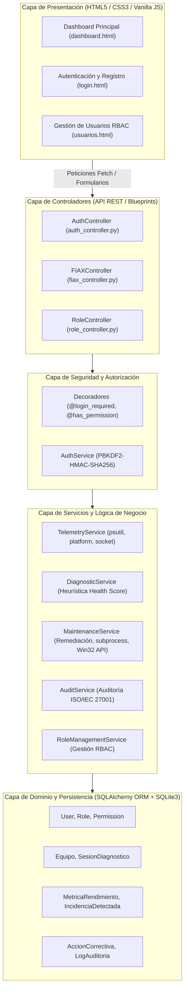

# MANUAL TÉCNICO Y ARQUITECTÓNICO ULTRA-DETALLADO: FIAX CPU
## Plataforma de Diagnóstico Heurístico, Telemetría y Mantenimiento Asistido
### Proyecto de Ingeniería de Sistemas - 10mo Semestre

---

## 1. VISIÓN GENERAL Y ARQUITECTURA DEL SISTEMA

FIAX CPU (*Fault Inspection & Automated eXecution for Computers*) es una solución cliente-servidor construida con un patrón de **Arquitectura en Capas (Layered / Clean Architecture)**. Su objetivo es diagnosticar el hardware del equipo anfitrión en tiempo real, identificar anomalías mediante heurísticas de rendimiento, ofrecer remediación asistida con un solo clic y conservar una pista forense de auditoría inmutable.

### 1.1 Diagrama de Relación entre Capas



---

## 2. CONFIGURACIÓN Y ENTORNO DEL SISTEMA (`config.py` y `app.py`)

### 2.1 Archivo `config.py`
Define los umbrales cuantitativos que gobiernan las decisiones heurísticas del motor de diagnóstico y la conexión a la base de datos relacional.

#### Bloque de Código:
```python
import os

class Config:
    """Configuración base del sistema FIAX CPU Web"""
    SECRET_KEY = os.environ.get('SECRET_KEY', 'fiax_cpu_secret_key_2026_systems_eng')
    SQLALCHEMY_TRACK_MODIFICATIONS = False
    SQLALCHEMY_DATABASE_URI = os.environ.get('DATABASE_URL', 'sqlite:///fiax_cpu_web.db')
    
    # Umbrales Heurísticos de Hardware para FIAX Diagnostic Engine
    THRESHOLD_CPU_WARNING = 70.0   # Porcentaje
    THRESHOLD_CPU_CRITICAL = 85.0  # Porcentaje
    THRESHOLD_RAM_WARNING = 75.0   # Porcentaje
    THRESHOLD_RAM_CRITICAL = 88.0  # Porcentaje
    THRESHOLD_DISK_FREE_GB_CRITICAL = 10.0 # GB libres mínimos recomendados
    THRESHOLD_DISK_FREE_GB_WARNING = 25.0  # GB

class DevelopmentConfig(Config):
    DEBUG = True

class ProductionConfig(Config):
    DEBUG = False

config_by_name = {
    'dev': DevelopmentConfig,
    'prod': ProductionConfig,
    'default': DevelopmentConfig
}
```

* **Qué hace:** Establece la llave criptográfica de sesión (`SECRET_KEY`), define el archivo físico SQLite (`instance/fiax_cpu_web.db`) y delimita las fronteras cuantitativas de estrés de hardware:
  * Si la CPU supera el 70%, emite advertencia; si supera el 85%, se declara estado crítico.
  * Si la RAM supera el 75%, emite advertencia; sobre el 88%, estado crítico.
  * Si el disco libre baja de 25 GB, alerta moderada; si baja de 10 GB, alerta crítica.

---

### 2.2 Archivo `app.py`
Es el punto de entrada que implementa el patrón **Application Factory (`create_app`)** y realiza la siembra inicial (*seeding*) de roles, permisos, usuario administrador y registro automático de la estación de trabajo física.

#### Bloque de Código - Factoría de la Aplicación y Enrutamiento Base:
```python
def create_app(config_name='default'):
    app = Flask(__name__)
    app.config.from_object(config_by_name[config_name])

    # Inicializar Extensiones
    db.init_app(app)

    # Registrar Blueprints Modulares
    app.register_blueprint(auth_bp)
    app.register_blueprint(role_bp)
    app.register_blueprint(fiax_bp)

    @app.route('/')
    def index():
        if 'user_id' in session:
            return redirect(url_for('dashboard'))
        return render_template('login.html')

    @app.route('/dashboard')
    def dashboard():
        if 'user_id' not in session:
            return redirect(url_for('index'))

        user_role = session.get('user_role', RoleEnum.USUARIO.value)
        user_name = session.get('user_name', 'Usuario')
        
        # Obtener ficha del equipo anfitrión y último diagnóstico registrado
        equipo = TelemetryService.get_or_register_host_equipo()
        ultimo_diag = DiagnosticService.get_latest_diagnostic_summary()

        return render_template(
            'dashboard.html',
            user_name=user_name,
            user_role=user_role,
            user_id=session.get('user_id'),
            equipo=equipo.to_dict() if equipo else {},
            ultimo_diag=ultimo_diag
        )
```

#### Bloque de Código - Siembra de Datos Inicial (`setup_initial_data`):
```python
def setup_initial_data():
    with app.app_context():
        db.create_all()
        role_service = RoleManagementService()

        # 1. Crear Permisos del Sistema
        for p_enum in PermissionEnum:
            if not Permission.query.filter_by(nombre=p_enum.value).first():
                db.session.add(Permission(nombre=p_enum.value, descripcion=f"Permiso para {p_enum.value.lower()}"))
        db.session.commit()

        # 2. Crear Roles por Defecto
        admin_role = role_service.create_role(RoleEnum.ADMINISTRADOR.value, "Administrador con control total del sistema")
        tecnico_role = role_service.create_role(RoleEnum.TECNICO.value, "Técnico especialista en diagnóstico y optimización")
        usuario_role = role_service.create_role(RoleEnum.USUARIO.value, "Usuario estándar con acceso a salud de su equipo")
        
        # 3. Usuario Administrador por Defecto
        if not User.query.filter_by(correo="admin@fiax.com").first():
            pass_hash = AuthService.hash_password("admin123")
            admin_user = User(nombre_completo="Erick Garcia", correo="admin@fiax.com", password_hash=pass_hash)
            admin_user.roles.append(admin_role)
            db.session.add(admin_user)
            db.session.commit()

        # 4. Registro automático del equipo físico y diagnóstico base
        equipo = TelemetryService.get_or_register_host_equipo()
        if not SesionDiagnostico.query.first():
            DiagnosticService.execute_complete_diagnosis(user_id=admin_user.id)
```

---

## 3. MODELO DE DOMINIO Y PERSISTENCIA (`domain/enums.py` y `domain/models.py`)

### 3.1 Enumeraciones de Dominio (`domain/enums.py`)
Garantizan coherencia semántica en la base de datos evitando cadenas mágicas dispersas.

```python
class RoleEnum(str, Enum):
    ADMINISTRADOR = "ADMINISTRADOR"
    TECNICO = "TECNICO"
    USUARIO = "USUARIO"

class PermissionEnum(str, Enum):
    USER_CREATE = "USER_CREATE"
    USER_READ = "USER_READ"
    ROLE_ASSIGN = "ROLE_ASSIGN"
    DIAGNOSTIC_RUN = "DIAGNOSTIC_RUN"
    REPORT_READ = "REPORT_READ"
    FIX_EXECUTE = "FIX_EXECUTE"
    MAINTENANCE_RUN = "MAINTENANCE_RUN"
    AUDIT_READ = "AUDIT_READ"

class SeveridadEnum(str, Enum):
    BAJO = "BAJO"
    MEDIO = "MEDIO"
    ALTO = "ALTO"
    CRITICO = "CRITICO"

class EstadoIncidenciaEnum(str, Enum):
    PENDIENTE = "PENDIENTE"
    EN_PROCESO = "EN_PROCESO"
    RESUELTA = "RESUELTA"

class TipoIncidenciaEnum(str, Enum):
    ALTO_CONSUMO_CPU = "ALTO_CONSUMO_CPU"
    SATURACION_RAM = "SATURACION_RAM"
    ESPACIO_DISCO_BAJO = "ESPACIO_DISCO_BAJO"
    PROCESO_ANOMALO = "PROCESO_ANOMALO"
    DRIVER_DESACTUALIZADO = "DRIVER_DESACTUALIZADO"
    CACHE_SOBREDIMENSIONADO = "CACHE_SOBREDIMENSIONADO"
```

---

### 3.2 Entidades del ORM (`domain/models.py`)

#### 1. Activación de Claves Foráneas en SQLite
SQLite no activa claves foráneas por defecto. FIAX CPU intercepta la conexión nativa con un *listener* de SQLAlchemy:
```python
@event.listens_for(Engine, "connect")
def set_sqlite_pragma(dbapi_connection, connection_record):
    """Garantiza que la integridad referencial y claves foráneas estén activas en SQLite."""
    cursor = dbapi_connection.cursor()
    cursor.execute("PRAGMA foreign_keys=ON")
    cursor.close()
```

#### 2. Entidad `User`, `Role` y `Permission` (RBAC Granular)
```python
user_roles = db.Table('user_roles',
    db.Column('user_id', db.Integer, db.ForeignKey('usuarios.id', ondelete="CASCADE"), primary_key=True),
    db.Column('role_id', db.Integer, db.ForeignKey('roles.id', ondelete="CASCADE"), primary_key=True)
)

class User(db.Model):
    __tablename__ = 'usuarios'
    id = db.Column(db.Integer, primary_key=True, autoincrement=True)
    nombre_completo = db.Column(db.String(100), nullable=False)
    correo = db.Column(db.String(120), unique=True, nullable=False)
    password_hash = db.Column(db.String(255), nullable=False)
    created_at = db.Column(db.DateTime, default=get_utc_now)
    
    roles = db.relationship('Role', secondary=user_roles, lazy='subquery',
                            backref=db.backref('usuarios', lazy=True))
    sesiones = db.relationship('SesionDiagnostico', backref='usuario', lazy=True)
    auditorias = db.relationship('LogAuditoria', backref='usuario', lazy=True)
```
* **Qué hace:** Almacena a cada usuario, protegiendo su contraseña con hash seguro y asociándolo con roles a través de una tabla intermedia de muchos a muchos.

#### 3. Entidad `Equipo` (Ficha Técnica de la Estación Host)
```python
class Equipo(db.Model):
    __tablename__ = 'equipos'
    id = db.Column(db.Integer, primary_key=True, autoincrement=True)
    nombre_equipo = db.Column(db.String(100), nullable=False)
    os_version = db.Column(db.String(150), nullable=False)
    arquitectura = db.Column(db.String(50))
    ram_total_gb = db.Column(db.Float)
    procesador = db.Column(db.String(150))
    ip_local = db.Column(db.String(50), default="127.0.0.1")
    fecha_registro = db.Column(db.DateTime, default=get_utc_now)
    ultima_conexion = db.Column(db.DateTime, default=get_utc_now)
```
* **Qué hace:** Registra el perfil físico inmutable del equipo: procesador real, memoria RAM instalada, versión de Windows/Linux y dirección IP de enlace.

#### 4. Entidad `SesionDiagnostico` y `MetricaRendimiento`
```python
class SesionDiagnostico(db.Model):
    __tablename__ = 'sesiones_diagnostico'
    id = db.Column(db.Integer, primary_key=True, autoincrement=True)
    equipo_id = db.Column(db.Integer, db.ForeignKey('equipos.id', ondelete="CASCADE"), nullable=False)
    usuario_id = db.Column(db.Integer, db.ForeignKey('usuarios.id', ondelete="SET NULL"), nullable=True)
    fecha_hora = db.Column(db.DateTime, default=get_utc_now)
    estado = db.Column(db.String(50), default='COMPLETADO')
    score_salud = db.Column(db.Integer, default=100) # Rango: 15 a 100
    resumen = db.Column(db.String(255))

class MetricaRendimiento(db.Model):
    __tablename__ = 'metricas_rendimiento'
    id = db.Column(db.Integer, primary_key=True, autoincrement=True)
    diagnostico_id = db.Column(db.Integer, db.ForeignKey('sesiones_diagnostico.id', ondelete="CASCADE"), nullable=False)
    uso_cpu_porcentaje = db.Column(db.Float, nullable=False)
    uso_ram_porcentaje = db.Column(db.Float, nullable=False)
    ram_usada_gb = db.Column(db.Float)
    ram_libre_gb = db.Column(db.Float)
    disco_libre_gb = db.Column(db.Float)
    disco_usado_porcentaje = db.Column(db.Float)
    procesos_activos = db.Column(db.Integer)
```
* **Qué hace:** Congela el estado métrico exacto del hardware en el instante que se corrió la inspección heurística.

#### 5. Entidad `IncidenciaDetectada` y `AccionCorrectiva`
```python
class IncidenciaDetectada(db.Model):
    __tablename__ = 'incidencias_detectadas'
    id = db.Column(db.Integer, primary_key=True, autoincrement=True)
    diagnostico_id = db.Column(db.Integer, db.ForeignKey('sesiones_diagnostico.id', ondelete="CASCADE"), nullable=False)
    tipo_incidencia = db.Column(db.String(60), nullable=False)
    componente_afectado = db.Column(db.String(100), nullable=False)
    descripcion = db.Column(db.Text, nullable=False)
    nivel_severidad = db.Column(db.String(20), default='MEDIO') # BAJO, MEDIO, ALTO, CRITICO
    estado = db.Column(db.String(20), default='PENDIENTE')     # PENDIENTE, RESUELTA

class AccionCorrectiva(db.Model):
    __tablename__ = 'acciones_correctivas'
    id = db.Column(db.Integer, primary_key=True, autoincrement=True)
    incidencia_id = db.Column(db.Integer, db.ForeignKey('incidencias_detectadas.id', ondelete="CASCADE"), nullable=False)
    solucion_recomendada = db.Column(db.Text, nullable=False)
    tipo_accion = db.Column(db.String(50), default="SISTEMA") # LIMPIEZA_TEMP, FLUSH_DNS, OPTIMIZAR_RAM
    autorizada_por_usuario = db.Column(db.Integer, default=0)
    ejecutada_con_exito = db.Column(db.Integer, default=0)
    resultado_log = db.Column(db.Text, nullable=True)
```
* **Qué hace:** Modela la relación 1 a 1 entre una falla detectada en la estación y la acción técnica requerida para solventarla.

#### 6. Entidad `LogAuditoria`
```python
class LogAuditoria(db.Model):
    __tablename__ = 'auditoria_logs'
    id = db.Column(db.Integer, primary_key=True, autoincrement=True)
    usuario_id = db.Column(db.Integer, db.ForeignKey('usuarios.id', ondelete="SET NULL"), nullable=True)
    modulo = db.Column(db.String(50), nullable=False) # AUTH, DIAGNOSTICO, MANTENIMIENTO, USUARIOS
    accion = db.Column(db.String(100), nullable=False)
    detalles = db.Column(db.Text)
    ip_origen = db.Column(db.String(45))
    nivel = db.Column(db.String(20), default="INFO") # INFO, WARNING, ERROR, CRITICAL
    fecha_hora = db.Column(db.DateTime, default=get_utc_now)
```
* **Qué hace:** Registra cada transacción sensible garantizando el principio de no repudio según los estándares ISO/IEC 27001.

---

## 4. CAPA DE SEGURIDAD Y CONTROL DE ACCESO (`security/decorators.py` y `services/auth_service.py`)

### 4.1 Decoradores de Control de Acceso (`security/decorators.py`)

#### Decorador `@has_permission`:
```python
def has_permission(required_permission):
    def decorator(f):
        @wraps(f)
        def decorated_function(*args, **kwargs):
            user_id = session.get('user_id')
            if not user_id:
                return jsonify({"error": "No autorizado. Inicie sesión."}), 401
            
            req_perm_str = required_permission.value if hasattr(required_permission, 'value') else str(required_permission)
            if not AuthorizationService.user_has_permission(user_id, req_perm_str):
                return jsonify({"error": f"Acceso denegado. Requiere el permiso: {req_perm_str}"}), 403
            
            return f(*args, **kwargs)
        return decorated_function
    return decorator
```
* **Qué hace:** Intercepta la petición HTTP a la API. Si el usuario no ha iniciado sesión, devuelve código `HTTP 401`. Si no cuenta con el permiso requerido (ej. `FIX_EXECUTE`), rechaza con código `HTTP 403 Forbidden`.

#### Decorador `@login_required`:
```python
def login_required(f):
    @wraps(f)
    def decorated_function(*args, **kwargs):
        user_id = session.get('user_id')
        if not user_id:
            return jsonify({"error": "No autorizado. Inicie sesión."}), 401
        return f(*args, **kwargs)
    return decorated_function
```

---

### 4.2 Servicio Criptográfico y de Autorización (`services/auth_service.py`)

```python
class AuthService:
    @staticmethod
    def hash_password(password: str) -> str:
        """Genera hash seguro con PBKDF2/SHA256 y salt aleatorio."""
        return generate_password_hash(password, method='pbkdf2:sha256')

    @staticmethod
    def verify_password(stored_hash: str, password: str) -> bool:
        """Verifica la contraseña con compatibilidad retroactiva para SHA-256 legacy."""
        if not stored_hash or not password:
            return False
        # Compatibilidad con hash legacy SHA-256 de 64 caracteres hex
        if len(stored_hash) == 64 and all(c in '0123456789abcdefABCDEF' for c in stored_hash):
            if hashlib.sha256(password.encode()).hexdigest().lower() == stored_hash.lower():
                return True
        try:
            return check_password_hash(stored_hash, password)
        except Exception:
            return False

class AuthorizationService:
    @staticmethod
    def user_has_permission(user_id: int, required_permission) -> bool:
        user = db.session.get(User, user_id)
        if not user:
            return False
            
        req_perm_str = required_permission.value if hasattr(required_permission, 'value') else str(required_permission)

        for role in user.roles:
            # Los administradores tienen acceso irrestricto
            if role.nombre == RoleEnum.ADMINISTRADOR.value:
                return True
            for perm in role.permissions:
                if perm.nombre == req_perm_str:
                    return True
        return False
```
* **Qué hace:** Emplea algoritmos de derivación de claves con salting criptográfico (`PBKDF2-HMAC-SHA256`). Si el rol del usuario es `ADMINISTRADOR`, otorga *bypass* directo hacia cualquier acción del sistema.

---

## 5. CAPA DE SERVICIOS Y LÓGICA DE NEGOCIO (`services/`)

### 5.1 Telemetría de Hardware Real (`services/telemetry_service.py`)

#### 1. Extracción de Identidad del Host:
```python
def get_hardware_profile():
    nombre_equipo = platform.node() or socket.gethostname() or "DESKTOP-LOCAL"
    os_ver = f"{platform.system()} {platform.release()} (Build {platform.version()})"
    arquitectura = platform.machine()
    procesador = platform.processor() or "Procesador Compatible x86_64"
    
    mem = psutil.virtual_memory()
    ram_total_gb = round(mem.total / (1024 ** 3), 2)
    
    # Obtener IP local activa
    try:
        s = socket.socket(socket.AF_INET, socket.SOCK_DGRAM)
        s.settimeout(2.0)
        s.connect(("8.8.8.8", 80))
        ip_local = s.getsockname()[0]
        s.close()
    except Exception:
        ip_local = "127.0.0.1"

    return {
        "nombre_equipo": nombre_equipo,
        "os_version": os_ver,
        "arquitectura": arquitectura,
        "procesador": procesador,
        "ram_total_gb": ram_total_gb,
        "ip_local": ip_local
    }
```

#### 2. Captura de Métricas Vivas e Inspección de Top Procesos:
```python
def get_live_metrics():
    # CPU
    cpu_pct = psutil.cpu_percent(interval=0.1)
    cpu_cores_logical = psutil.cpu_count(logical=True) or 4
    cpu_cores_physical = psutil.cpu_count(logical=False) or 2

    # Memoria RAM
    mem = psutil.virtual_memory()
    ram_pct = mem.percent
    ram_used_gb = round((mem.total - mem.available) / (1024 ** 3), 2)
    ram_free_gb = round(mem.available / (1024 ** 3), 2)
    ram_total_gb = round(mem.total / (1024 ** 3), 2)

    # Disco Principal del Sistema
    system_drive = os.getenv('SystemDrive', 'C:')
    disk_path = f"{system_drive}\\" if os.name == 'nt' else '/'
    disk = psutil.disk_usage(disk_path)
    disk_pct = disk.percent
    disk_free_gb = round(disk.free / (1024 ** 3), 2)

    # Top 5 Procesos por uso de memoria RAM
    top_procs = []
    for p in psutil.process_iter(['pid', 'name', 'cpu_percent', 'memory_percent', 'memory_info', 'status']):
        try:
            info = p.info
            name = info.get('name') or "Desconocido"
            mem_pct = round(info.get('memory_percent') or 0.0, 1)
            mem_mb = round((info.get('memory_info').rss / (1024 * 1024)), 1) if info.get('memory_info') else 0.0
            top_procs.append({
                "pid": info.get('pid'),
                "name": name,
                "cpu_percent": round(info.get('cpu_percent') or 0.0, 1),
                "memory_percent": mem_pct,
                "memory_mb": mem_mb,
                "status": info.get('status') or "running"
            })
        except (psutil.NoSuchProcess, psutil.AccessDenied, psutil.ZombieProcess, Exception):
            continue

    top_procs = sorted(top_procs, key=lambda x: x['memory_mb'], reverse=True)[:5]
```
* **Qué hace:** Emplea llamadas C de bajo nivel (`psutil`) para recolectar el porcentaje exacto de carga en procesador, memoria ocupada/libre, capacidad en GB del disco primario y clasifica los 5 subprocesos con mayor consumo de Working Set (RSS).

---

### 5.2 Motor de Diagnóstico Heurístico (`services/diagnostic_service.py`)

#### Formulación Matemática del Health Score:
$$H = \max\left(15, \min\left(100, 100 - \left( P_{\text{cpu}} + P_{\text{ram}} + P_{\text{disco}} + P_{\text{temp}} + \sum_{k=1}^{n} w_k \right)\right)\right)$$

#### Bloque de Código de la Fórmula Heurística:
```python
@staticmethod
def calculate_health_score(cpu_pct, ram_pct, disk_free_gb, temp_mb, incidents):
    score = 100.0

    # 1. Penalizaciones por CPU
    if cpu_pct >= 85.0:
        score -= 18.0
    elif cpu_pct >= 70.0:
        score -= 9.0

    # 2. Penalizaciones por Memoria RAM
    if ram_pct >= 88.0:
        score -= 22.0
    elif ram_pct >= 75.0:
        score -= 12.0
    elif ram_pct >= 60.0:
        score -= 5.0

    # 3. Penalizaciones por Disco Libre
    if disk_free_gb <= 15.0:
        score -= 25.0
    elif disk_free_gb <= 35.0:
        score -= 10.0

    # 4. Penalizaciones por Basura Temporal en %TEMP%
    if temp_mb >= 1000.0:
        score -= 10.0
    elif temp_mb >= 300.0:
        score -= 5.0

    # 5. Penalizaciones por Incidencias Activas
    for inc in incidents:
        sev = inc.get('severidad')
        if sev == SeveridadEnum.CRITICO.value:
            score -= 15.0
        elif sev == SeveridadEnum.ALTO.value:
            score -= 10.0
        elif sev == SeveridadEnum.MEDIO.value:
            score -= 5.0
        elif sev == SeveridadEnum.BAJO.value:
            score -= 2.0

    score = max(15, min(100, int(round(score))))
    return score
```

#### Ejecución del Diagnóstico y Transacción Atómica:
```python
@classmethod
def execute_complete_diagnosis(cls, user_id=None):
    equipo = TelemetryService.get_or_register_host_equipo()
    metrics = TelemetryService.get_live_metrics()
    
    cpu_pct = metrics['cpu']['usage_percent']
    ram_pct = metrics['ram']['usage_percent']
    disk_free_gb = metrics['disk']['free_gb']
    temp_mb, temp_files = cls.inspect_temp_cache_size()

    detected_incidents = []
    
    # Evaluación heurística de RAM
    if ram_pct >= 80.0:
        detected_incidents.append({
            "tipo": TipoIncidenciaEnum.SATURACION_RAM.value,
            "componente": f"Memoria RAM ({ram_pct}% en uso)",
            "descripcion": f"La memoria física presenta saturación ({metrics['ram']['used_gb']} GB de {metrics['ram']['total_gb']} GB).",
            "severidad": SeveridadEnum.ALTO.value if ram_pct < 90 else SeveridadEnum.CRITICO.value,
            "solucion": "Optimizar espacio de memoria activa y recortar el Working Set.",
            "tipo_accion": "OPTIMIZAR_RAM"
        })
    # Evaluación heurística de Archivos Temporales
    if temp_mb >= 250.0 or temp_files >= 200:
        detected_incidents.append({
            "tipo": TipoIncidenciaEnum.CACHE_SOBREDIMENSIONADO.value,
            "componente": "Directorio de Archivos Temporales (%TEMP%)",
            "descripcion": f"Se identificaron {temp_files} archivos residuales ({temp_mb} MB).",
            "severidad": SeveridadEnum.MEDIO.value,
            "solucion": "Purgar de manera segura archivos temporales obsoletos.",
            "tipo_accion": "LIMPIEZA_TEMP"
        })
    
    health_score = cls.calculate_health_score(cpu_pct, ram_pct, disk_free_gb, temp_mb, detected_incidents)
    
    # Persistencia en una sola transacción atómica
    sesion = SesionDiagnostico(
        equipo_id=equipo.id,
        usuario_id=user_id,
        fecha_hora=get_utc_now(),
        score_salud=health_score,
        resumen=f"Diagnóstico heurístico finalizado: Score {health_score}/100."
    )
    db.session.add(sesion)
    db.session.flush()
    # Se crean MetricaRendimiento e IncidenciaDetectada...
    db.session.commit()
```

---

### 5.3 Remediación y Mantenimiento Asistido (`services/maintenance_service.py`)

#### 1. Purga Segura de Temporales (`clean_temporary_files`):
```python
def clean_temporary_files():
    temp_dir = os.environ.get('TEMP') or os.environ.get('TMP')
    archivos_eliminados = 0
    bytes_liberados = 0

    for entry in os.scandir(temp_dir):
        try:
            if entry.is_file(follow_symlinks=False):
                size = entry.stat().st_size
                os.remove(entry.path)
                bytes_liberados += size
                archivos_eliminados += 1
        except (PermissionError, FileNotFoundError, OSError):
            # Archivos actualmente bloqueados por procesos activos de Windows se ignoran de forma segura
            continue

    mb_liberados = round(bytes_liberados / (1024 * 1024), 2)
    return {
        "success": True,
        "mensaje": f"Limpieza completada: {archivos_eliminados} archivos temporales purgados.",
        "mb_liberados": mb_liberados,
        "archivos_eliminados": archivos_eliminados
    }
```

#### 2. Vaciado de Caché DNS del Sistema Operativo (`flush_dns_cache`):
```python
def flush_dns_cache():
    try:
        if os.name == 'nt':
            res = subprocess.run(
                ["ipconfig", "/flushdns"],
                capture_output=True,
                text=True,
                timeout=10,
                creationflags=subprocess.CREATE_NO_WINDOW if hasattr(subprocess, 'CREATE_NO_WINDOW') else 0
            )
            output = res.stdout.strip() or "Se vació correctamente la caché de resolución de DNS."
        else:
            output = "Comando DNS completado (Plataforma no Windows)."

        return {"success": True, "mensaje": output, "comando": "ipconfig /flushdns"}
    except Exception as e:
        return {"success": False, "mensaje": f"No se pudo ejecutar flushdns: {str(e)}"}
```
* **Qué hace:** Ejecuta nativamente `ipconfig /flushdns` en la consola de comandos de Windows sin abrir ventanas negras molestas (`CREATE_NO_WINDOW`), eliminando nombres de dominio caducados o corruptos.

#### 3. Optimización de Memoria y Recorte de Working Set (`optimize_memory`):
```python
def optimize_memory():
    mem_antes = psutil.virtual_memory().percent
    gc.collect()

    # Vaciado de Working Sets en la API nativa de Windows (Win32 API)
    if os.name == 'nt':
        try:
            import ctypes
            for proc in psutil.process_iter(['pid']):
                try:
                    handle = ctypes.windll.kernel32.OpenProcess(0x001F0FFF, False, proc.info['pid'])
                    if handle:
                        ctypes.windll.psapi.EmptyWorkingSet(handle)
                        ctypes.windll.kernel32.CloseHandle(handle)
                except Exception:
                    pass
        except Exception:
            pass

    mem_despues = psutil.virtual_memory().percent
    diferencia = round(mem_antes - mem_despues, 1)
    
    return {
        "success": True,
        "mensaje": f"Optimización de memoria ejecutada. RAM antes: {mem_antes}%, RAM actual: {mem_despues}%.",
        "ram_antes": mem_antes,
        "ram_despues": mem_despues,
        "reduccion_porcentaje": diferencia
    }
```
* **Qué hace:** Llama a la biblioteca `kernel32.dll` y `psapi.dll` de Windows usando `ctypes`. Abre los *handles* de procesos inactivos y ejecuta `EmptyWorkingSet`, ordenándole al administrador de memoria de Windows enviar páginas inactivas al archivo de paginación y liberar RAM física instantáneamente.

#### 4. Resolución Asistida de Incidencias (`resolve_incident`):
```python
@classmethod
def resolve_incident(cls, incidencia_id: int, user_id: int = None):
    incidencia = db.session.get(IncidenciaDetectada, incidencia_id)
    accion = AccionCorrectiva.query.filter_by(incidencia_id=incidencia.id).first()
    tipo_accion = accion.tipo_accion if accion else "SISTEMA"

    if tipo_accion == "LIMPIEZA_TEMP":
        resultado = cls.clean_temporary_files()
    elif tipo_accion == "FLUSH_DNS":
        resultado = cls.flush_dns_cache()
    elif tipo_accion == "OPTIMIZAR_RAM":
        resultado = cls.optimize_memory()

    incidencia.estado = EstadoIncidenciaEnum.RESUELTA.value
    accion.autorizada_por_usuario = 1
    accion.ejecutada_con_exito = 1 if resultado.get("success") else 0
    accion.fecha_ejecucion = get_utc_now()
    accion.resultado_log = resultado.get("mensaje", "Ejecutado con éxito")
    db.session.commit()

    AuditService.registrar(
        accion="RESOLVER_INCIDENCIA",
        modulo="MANTENIMIENTO",
        detalles=f"Incidencia #{incidencia.id} ({incidencia.tipo_incidencia}) resuelta.",
        usuario_id=user_id
    )
```

---

## 6. CAPA DE CONTROLADORES Y API REST (`controllers/`)

### 6.1 `fiax_controller.py`
Endpoints principales para la interfaz web asíncrona:

```python
# GET: Consulta de Telemetría Viva
@fiax_bp.route('/telemetria', methods=['GET'])
@login_required
def get_telemetria():
    metrics = TelemetryService.get_live_metrics()
    equipo = TelemetryService.get_hardware_profile()
    return jsonify({"success": True, "equipo": equipo, "metricas": metrics})

# POST: Disparo del Motor Heurístico
@fiax_bp.route('/diagnostico/ejecutar', methods=['POST'])
@has_permission(PermissionEnum.DIAGNOSTIC_RUN)
def ejecutar_diagnostico():
    user_id = session.get('user_id')
    resultado = DiagnosticService.execute_complete_diagnosis(user_id=user_id)
    return jsonify(resultado), (200 if resultado.get('success') else 500)

# POST: Resolución de Incidencia Individual
@fiax_bp.route('/incidencias/<int:incidencia_id>/resolver', methods=['POST'])
@has_permission(PermissionEnum.FIX_EXECUTE)
def resolver_incidencia(incidencia_id):
    user_id = session.get('user_id')
    resultado = MaintenanceService.resolve_incident(incidencia_id, user_id=user_id)
    return jsonify(resultado), (200 if resultado.get('success') else 400)

# POST: Optimización Rápida Global
@fiax_bp.route('/mantenimiento/optimizar', methods=['POST'])
@has_permission(PermissionEnum.MAINTENANCE_RUN)
def optimizacion_rapida():
    user_id = session.get('user_id')
    res_temp = MaintenanceService.clean_temporary_files()
    res_dns = MaintenanceService.flush_dns_cache()
    res_mem = MaintenanceService.optimize_memory()
    return jsonify({
        "success": True,
        "mensaje": "Optimización del sistema completada exitosamente.",
        "resultados": {"temporales": res_temp, "dns": res_dns, "memoria": res_mem}
    })
```

---

### 6.2 `role_controller.py` (CRUD Administrativo de Usuarios)
Controla las operaciones de administración de cuentas de usuario con protección de auto-eliminación y protección del último administrador existente.

```python
# DELETE: Eliminar un usuario con protecciones de seguridad
@role_bp.route('/users/<int:user_id>', methods=['DELETE'])
@has_permission(PermissionEnum.USER_CREATE)
def delete_user(user_id):
    user = db.session.get(User, user_id)
    if not user:
        return jsonify({"error": "Usuario no encontrado."}), 404

    # Regla 1: No auto-eliminarse
    if user.id == session.get('user_id'):
        return jsonify({"error": "No puede eliminar su propia cuenta activa."}), 400

    # Regla 2: Proteger al último administrador
    es_admin = any(r.nombre == RoleEnum.ADMINISTRADOR.value for r in user.roles)
    if es_admin:
        admin_count = User.query.filter(User.roles.any(Role.nombre == RoleEnum.ADMINISTRADOR.value)).count()
        if admin_count <= 1:
            return jsonify({"error": "No se puede eliminar el único Administrador del sistema."}), 400

    correo_eliminado = user.correo
    db.session.delete(user)
    db.session.commit()
    return jsonify({"message": "Usuario eliminado exitosamente."})
```

---

## 7. CATÁLOGO EXHAUSTIVO DE COMPONENTES DE INTERFAZ GRÁFICA (FRONTEND)

A continuación se detalla cada componente visual, mostrando el **HTML**, el **bloque CSS con el color exacto**, el **manejador JavaScript** y la **acción que desencadena**.

---

### COMPONENTE 1: Botón Rojo de Cierre de Sesión en el Menú Lateral (Sidebar)
* **Ubicación:** `templates/dashboard.html` (Líneas 221-244, 933-938) y `templates/usuarios.html` (Líneas 205-228, 628-633).
* **Propósito:** Permite al usuario activo desconectarse de la plataforma y destruir la sesión del servidor de forma inmediata.

#### 1. Código HTML del Botón:
```html
<div class="sidebar-footer">
    <a href="/logout" class="btn-logout-sidebar">
        <i class="fa-solid fa-arrow-right-from-bracket"></i>
        <span>Cerrar Sesión Activa</span>
    </a>
</div>
```

#### 2. Código CSS que define el Color Rojo:
```css
.btn-logout-sidebar {
    display: flex;
    align-items: center;
    justify-content: center;
    gap: 10px;
    width: 100%;
    padding: 12px;
    border-radius: 8px;
    /* Fondo rojo traslúcido inicial */
    background-color: rgba(239, 68, 68, 0.12);
    /* Texto rojo claro */
    color: #f87171;
    /* Borde rojo de advertencia */
    border: 1px solid rgba(239, 68, 68, 0.35);
    font-weight: 700;
    font-size: 13.5px;
    text-decoration: none;
    transition: all 0.2s ease;
    cursor: pointer;
}

/* Efecto hover: rojo vivo con sombra resplandeciente */
.btn-logout-sidebar:hover {
    background-color: #ef4444; /* Color rojo puro hex */
    color: white;
    box-shadow: 0 4px 15px rgba(239, 68, 68, 0.4);
    transform: translateY(-1px);
}
```

#### 3. Código Backend que ejecuta la Acción:
```python
# Ubicación: controllers/auth_controller.py
@auth_bp.route('/logout')
def logout():
    user_id = session.get('user_id')
    user_name = session.get('user_name')
    if user_id:
        AuditService.registrar(
            accion="CIERRE_SESION",
            modulo="AUTH",
            detalles=f"Usuario {user_name} cerró sesión.",
            nivel="INFO",
            usuario_id=user_id
        )
    session.clear() # Destruye las cookies de sesión
    return redirect(url_for('index')) # Redirige a la pantalla de login
```

---

### COMPONENTE 2: Botón Rojo de Eliminar Usuario en Tabla RBAC
* **Ubicación:** `templates/usuarios.html` (Líneas 328-345, 852, 940-955).
* **Propósito:** Elimina permanentemente a un usuario seleccionado de la base de datos previa confirmación en ventana modal del navegador.

#### 1. Código HTML del Botón:
```html
<button class="btn-delete" onclick="deleteUser(u.id)">
    <i class="fa-solid fa-trash"></i> Eliminar
</button>
```

#### 2. Código CSS que define el Color Rojo:
```css
.btn-delete {
    background-color: #dc2626; /* Rojo oscuro de peligro */
    color: white;
    border: none;
    padding: 7px 12px;
    border-radius: 6px;
    cursor: pointer;
    font-weight: 700;
    font-size: 12px;
    display: inline-flex;
    align-items: center;
    gap: 5px;
    transition: 0.2s;
}

.btn-delete:hover {
    background-color: #b91c1c; /* Rojo intenso al pasar el mouse */
}
```

#### 3. Código JavaScript que procesa el Clic:
```javascript
async function deleteUser(id) {
    if (!confirm("¿Está seguro de que desea eliminar este usuario del sistema?")) return;

    try {
        const res = await fetch(`/api/v1/users/${id}`, { method: 'DELETE' });
        const result = await res.json();

        if (res.ok) {
            loadUsers(); // Recarga la tabla dinámicamente sin recargar la página
        } else {
            alert("Error: " + (result.error || "No se pudo eliminar el usuario."));
        }
    } catch (err) {
        alert("Error de conexión con el servidor.");
    }
}
```

---

### COMPONENTE 3: Modal Emergente Rojo de Error en Inicio de Sesión
* **Ubicación:** `templates/login.html` (Líneas 103-169, 207-216, 237-242).
* **Propósito:** Muestra un cuadro modal rojo con animación de desvanecimiento cuando el usuario introduce una contraseña incorrecta.

#### 1. Código HTML del Modal y su Botón de Aceptar:
```html

<div class="modal-overlay" id="errorModal">
    <div class="popup">
        <div class="popup-icon">⚠️</div>
        <h3>Credenciales Inválidas</h3>
        <p>{{ error_login }}</p>
        <button class="popup-btn" onclick="closePopup()">Aceptar</button>
    </div>
</div>

```

#### 2. Código CSS que define los Colores Rojos del Modal:
```css
.popup {
    background-color: #1e293b;
    padding: 25px;
    border-radius: 14px;
    width: 320px;
    text-align: center;
    border: 1px solid #ef4444; /* Borde rojo */
    box-shadow: 0 10px 25px rgba(239, 68, 68, 0.2); /* Resplandor rojo */
}

.popup-icon {
    font-size: 40px;
    color: #ef4444; /* Color rojo del icono */
    margin-bottom: 10px;
}

.popup-btn {
    background-color: #ef4444; /* Fondo rojo del botón */
    color: white;
    border: none;
    padding: 10px 25px;
    border-radius: 6px;
    font-weight: bold;
    cursor: pointer;
    width: 100%;
    font-size: 14px;
}

.popup-btn:hover {
    background-color: #dc2626; /* Rojo más oscuro al hover */
}
```

#### 3. Código JavaScript que cierra el Modal:
```javascript
function closePopup() {
    const modal = document.getElementById('errorModal');
    if (modal) {
        modal.style.display = 'none';
    }
}
```

---

### COMPONENTE 4: Botón Azul "Ejecutar Diagnóstico Heurístico"
* **Ubicación:** `templates/dashboard.html` (Líneas 298-306, 953-954, 1363-1413).
* **Propósito:** Dispara la evaluación completa del sistema, despliega el modal animado con barra de progreso y recalcula el Health Score.

#### 1. Código HTML del Botón:
```html
<button class="btn btn-primary" onclick="triggerCompleteDiagnosis()">
    <i class="fa-solid fa-bolt"></i> Ejecutar Diagnóstico Heurístico
</button>
```

#### 2. Código CSS que define el Gradiente Azul:
```css
.btn-primary {
    background: linear-gradient(135deg, #0284c7, #2563eb); /* Gradiente azul cyan a azul eléctrico */
    color: white;
    border: none;
    padding: 10px 18px;
    border-radius: 8px;
    font-weight: 700;
    font-size: 13px;
    cursor: pointer;
    box-shadow: 0 4px 12px rgba(2, 132, 199, 0.3); /* Sombra azul */
    transition: all 0.2s ease;
}

.btn-primary:hover {
    background: linear-gradient(135deg, #0369a1, #1d4ed8);
    transform: translateY(-1px);
}
```

#### 3. Código JavaScript que ejecuta la Petición y Anima el Modal:
```javascript
async function triggerCompleteDiagnosis() {
    const modal = document.getElementById('diagModal');
    const stepText = document.getElementById('modalDiagStep');
    modal.style.display = 'flex'; // Abre el modal de escaneo

    const steps = [
        "Inspeccionando uso térmico y estrés de CPU...",
        "Evaluando contención de páginas en memoria RAM...",
        "Auditando archivos temporales y fragmentación de caché...",
        "Calculando Health Score ponderado y registrando sesión..."
    ];

    let stepIdx = 0;
    const interval = setInterval(() => {
        stepIdx = (stepIdx + 1) % steps.length;
        stepText.innerText = steps[stepIdx]; // Cambia el texto cada 600ms
    }, 600);

    try {
        const res = await fetch('/api/v1/fiax/diagnostico/ejecutar', { method: 'POST' });
        const result = await res.json();
        clearInterval(interval);
        modal.style.display = 'none';

        if (result.success) {
            showToast(`Diagnóstico completado con éxito. Score: ${result.score_salud}/100`, "success");
            document.getElementById('txt-health-score').innerHTML = `${result.score_salud}<span style="font-size: 20px; font-weight: 500;">/100</span>`;
            fetchLiveTelemetry(); // Actualiza tarjetas
            loadIncidents();      // Actualiza lista de incidencias
        }
    } catch (err) {
        clearInterval(interval);
        modal.style.display = 'none';
        showToast("Error de conexión al servidor.", "error");
    }
}
```

---

### COMPONENTE 5: Botón Verde "Ejecutar Mantenimiento Rápido"
* **Ubicación:** `templates/dashboard.html` (Líneas 308-315, 1142-1144, 1501-1516).
* **Propósito:** Aplica en una sola llamada la limpieza de temporales, vaciado de caché DNS y optimización de memoria RAM.

#### 1. Código HTML del Botón:
```html
<button class="btn btn-success" onclick="runGlobalOptimization()">
    <i class="fa-solid fa-bolt-lightning"></i> Ejecutar Mantenimiento Rápido
</button>
```

#### 2. Código CSS que define el Color Verde Esmeralda:
```css
:root {
    --color-green: #10b981; /* Verde esmeralda */
}

.btn-success {
    background-color: var(--color-green);
    color: white;
    padding: 10px 18px;
    border-radius: 8px;
    font-weight: 700;
    font-size: 13px;
    border: none;
    cursor: pointer;
    display: inline-flex;
    align-items: center;
    gap: 8px;
    transition: all 0.2s ease;
}

.btn-success:hover {
    background-color: #059669; /* Verde oscuro */
}
```

#### 3. Código JavaScript que orquesta la Solicitud:
```javascript
async function runGlobalOptimization() {
    showToast("Iniciando rutina integral de optimización...", "info");
    try {
        const res = await fetch('/api/v1/fiax/mantenimiento/optimizar', { method: 'POST' });
        const data = await res.json();
        if (data.success) {
            showToast(data.mensaje, "success");
            fetchLiveTelemetry(); // Refresca medidores
            loadIncidents();      // Limpia advertencias resueltas
        } else {
            showToast("Error en la optimización: " + (data.error || "Fallo interno"), "error");
        }
    } catch (err) {
        showToast("Error al conectar con el servidor.", "error");
    }
}
```

---

### COMPONENTE 6: Botón Naranja de Editar Usuario en Tabla RBAC
* **Ubicación:** `templates/usuarios.html` (Líneas 308-326, 851, 878-886).
* **Propósito:** Abre el formulario modal precargando los datos del usuario para modificar su nombre, correo o rol institucional.

#### 1. Código HTML del Botón:
```html
<button class="btn-edit" onclick="openEditModal(u.id, 'Carlos Mendoza', 'carlos@fiax.com', 2)">
    <i class="fa-solid fa-pen"></i> Editar
</button>
```

#### 2. Código CSS que define el Color Ámbar / Naranja:
```css
.btn-edit {
    background-color: #d97706; /* Color ámbar/naranja */
    color: white;
    border: none;
    padding: 7px 12px;
    border-radius: 6px;
    cursor: pointer;
    font-weight: 700;
    font-size: 12px;
    margin-right: 6px;
    display: inline-flex;
    align-items: center;
    gap: 5px;
    transition: 0.2s;
}

.btn-edit:hover {
    background-color: #b45309; /* Naranja más profundo al hover */
}
```

#### 3. Código JavaScript que procesa la Apertura:
```javascript
function openEditModal(id, nombre, correo, roleId) {
    document.getElementById('modalTitle').innerHTML = '<i class="fa-solid fa-user-pen"></i> Editar Datos de Usuario';
    document.getElementById('userId').value = id;
    document.getElementById('userNombre').value = nombre;
    document.getElementById('userCorreo').value = correo;
    document.getElementById('userPassword').value = '';
    populateRolesSelect(roleId);
    document.getElementById('userModal').style.display = 'flex';
}
```

---

### COMPONENTE 7: Insignias de Severidad de Incidencias (Rojo, Naranja, Amarillo, Azul)
* **Ubicación:** `templates/dashboard.html` (Líneas 668-701, 1441-1443).
* **Propósito:** Etiqueta visualmente la gravedad del cuello de botella en el hardware.

#### 1. Código HTML:
```html
<span class="badge-sev CRITICO">
    <i class="fa-solid fa-fire"></i> SEVERIDAD CRITICO
</span>
```

#### 2. Código CSS que define los 4 Colores:
```css
/* Rojo para CRÍTICO */
.badge-sev.CRITICO {
    background-color: rgba(239, 68, 68, 0.25);
    color: #f87171;
    border: 1px solid #ef4444;
}

/* Naranja para ALTO */
.badge-sev.ALTO {
    background-color: rgba(249, 115, 22, 0.25);
    color: #fb923c;
    border: 1px solid #f97316;
}

/* Amarillo para MEDIO */
.badge-sev.MEDIO {
    background-color: rgba(245, 158, 11, 0.25);
    color: #fbbf24;
    border: 1px solid #f59e0b;
}

/* Azul para BAJO */
.badge-sev.BAJO {
    background-color: rgba(59, 130, 246, 0.25);
    color: #60a5fa;
    border: 1px solid #3b82f6;
}
```

---

### COMPONENTE 8: Píldoras de Estado Dinámico en las Métricas de Hardware
* **Ubicación:** `templates/dashboard.html` (Líneas 500-528, 1294-1335).
* **Propósito:** Muestra si el consumo de CPU, RAM o Disco está en rango "Normal" (Verde), "Elevado" (Amarillo) o "Crítico / Saturado" (Rojo).

#### 1. Código HTML:
```html
<span class="metric-state-pill state-normal" id="state-cpu">
    <i class="fa-solid fa-circle"></i> Normal
</span>
```

#### 2. Código CSS con los Colores de Estado:
```css
/* Verde para Normal */
.state-normal {
    background: rgba(16, 185, 129, 0.2);
    color: #34d399;
    border: 1px solid #10b981;
}

/* Amarillo para Warning */
.state-warning {
    background: rgba(245, 158, 11, 0.2);
    color: #fbbf24;
    border: 1px solid #f59e0b;
}

/* Rojo para Critical */
.state-critical {
    background: rgba(239, 68, 68, 0.2);
    color: #f87171;
    border: 1px solid #ef4444;
}
```

#### 3. Código JavaScript que evalúa los Umbrales y conmuta la clase:
```javascript
const stateCpu = document.getElementById('state-cpu');
if (m.cpu.usage_percent >= 80) {
    stateCpu.className = 'metric-state-pill state-critical';
    stateCpu.innerHTML = '<i class="fa-solid fa-circle"></i> Saturado';
} else if (m.cpu.usage_percent >= 60) {
    stateCpu.className = 'metric-state-pill state-warning';
    stateCpu.innerHTML = '<i class="fa-solid fa-circle"></i> Carga Media';
} else {
    stateCpu.className = 'metric-state-pill state-normal';
    stateCpu.innerHTML = '<i class="fa-solid fa-circle"></i> Normal';
}
```

---

## 8. BATERÍA DE PRUEBAS UNITARIAS (`tests/test_fiax.py`)

El sistema incluye una suite formal de 12 pruebas unitarias construidas sobre el módulo nativo `unittest` de Python:

| Identificador | Prueba | Capa Evaluada | Criterio de Aceptación |
| :--- | :--- | :--- | :--- |
| `test_01` | `login_success` | `AuthController` | Código 302 y redirección a `/dashboard` con credenciales válidas. |
| `test_02` | `login_invalid_password` | `AuthController` | Código 200 y mensaje "Credenciales inválidas" ante contraseñas incorrectas. |
| `test_03` | `registration_and_logout` | `AuthService` | Validación de contraseñas desiguales y cierre seguro de sesión. |
| `test_04` | `hardware_telemetry` | `TelemetryService` | Lectura de CPU, RAM, disco y procesos reales sin emulaciones. |
| `test_05` | `health_score_calculation` | `DiagnosticService` | Score 100 en reposo y score $\le 40$ bajo estrés crítico de recursos. |
| `test_06` | `complete_diagnosis_execution`| `DiagnosticService` | Creación atómica de sesión, métricas e incidencias en SQLite. |
| `test_07` | `maintenance_routines` | `MaintenanceService` | Purga exitosa de temporales, flush DNS y optimización de memoria RAM. |
| `test_08` | `resolve_incident` | `MaintenanceService` | Cambio de estado de la incidencia a `RESUELTA`. |
| `test_09` | `audit_logging` | `AuditService` | Escritura inmutable en `auditoria_logs` con IP y fecha UTC. |
| `test_10` | `rbac_access_control` | `Security` | Bloqueo 401 a peticiones anónimas y 200 a peticiones de administrador. |
| `test_11` | `user_crud_and_protections` | `RoleController` | Inhabilidad de eliminar al único administrador o auto-eliminarse. |
| `test_12` | `template_rendering` | `Flask Jinja2` | Redirección forzada al intentar entrar a `/dashboard` sin autenticarse. |

---

## 9. GUÍA DE EJECUCIÓN DEL PROYECTO

1. **Instalar dependencias:**
   ```bash
   pip install -r requirements.txt
   ```
2. **Ejecutar pruebas automatizadas:**
   ```bash
   python -m unittest tests/test_fiax.py
   ```
3. **Iniciar el servidor web de desarrollo:**
   ```bash
   python app.py
   ```
4. **Acceso:**
   * Navegar a: `http://127.0.0.1:5000`
   * Administrador: `admin@fiax.com` / `admin123`
   * Técnico: `tecnico@fiax.com` / `tecnico123`

